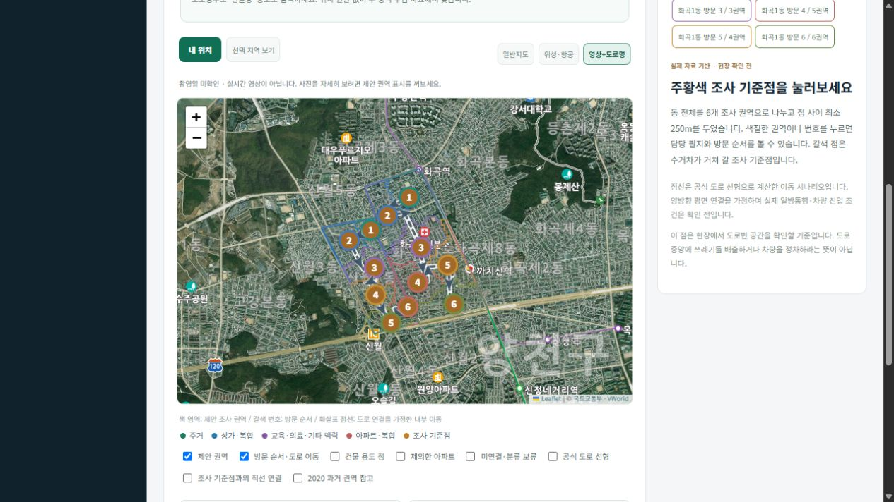
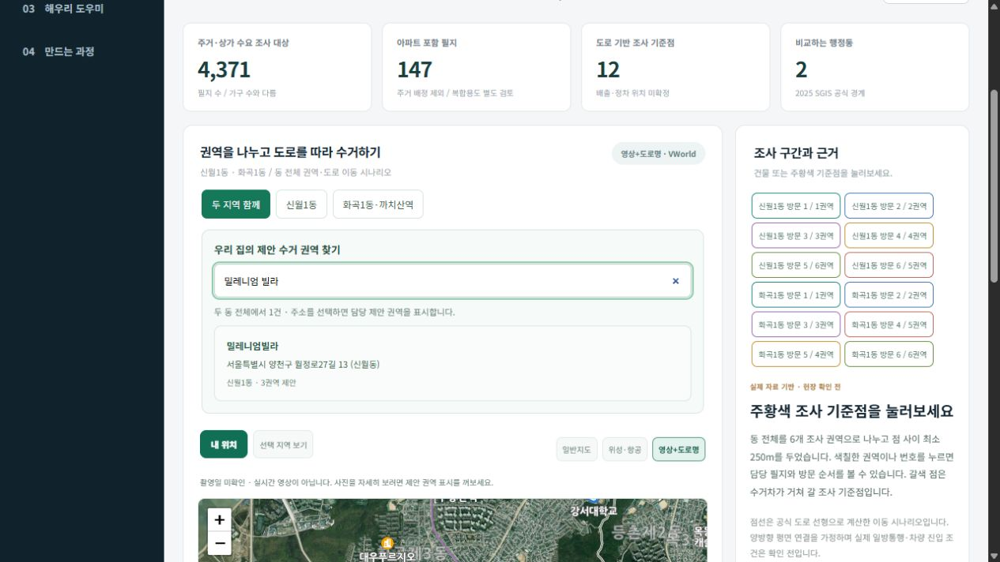
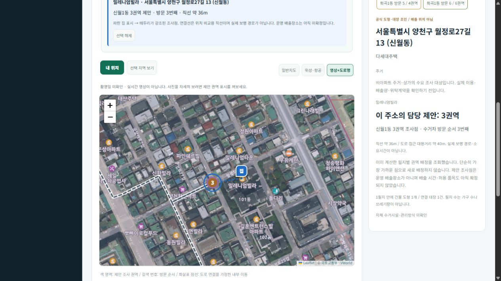
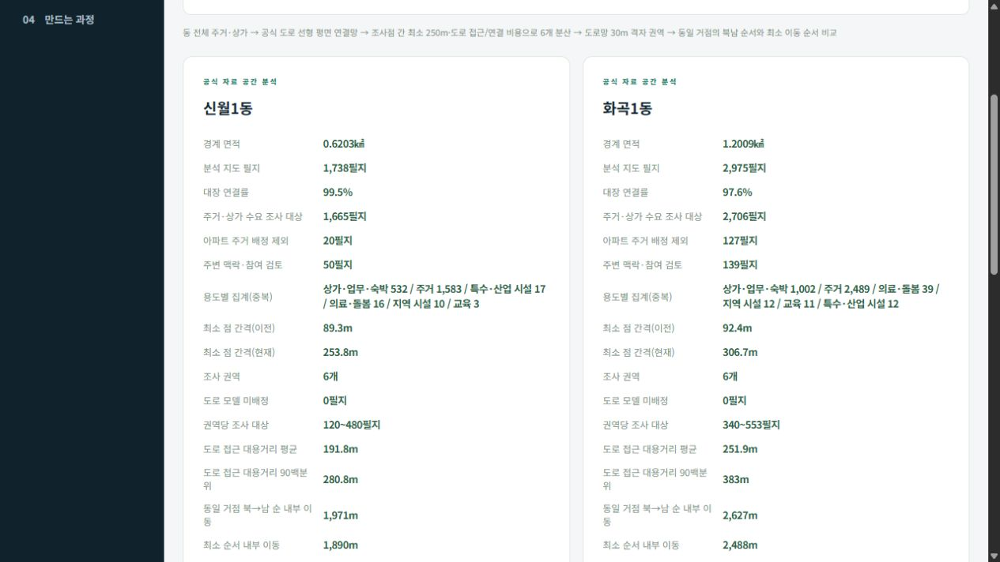

# 그린존 프리뷰 - 팀원 공유 안내

[3쪽 화면 가이드 PDF](../output/pdf/그린존_프리뷰_팀원_화면가이드.pdf) · [Docker 실행 안내](../QUICK_START_KO.md)

## 이렇게 설명하려고 합니다

아파트 밖의 주거·상가에서도 주소를 입력하면 담당 제안 수거 권역을 확인할 수 있으면 좋겠다고 생각했습니다. 그 아이디어를 AI와 대화하며 코딩하는 방식으로 먼저 작게 구현해 봤습니다. 신월1동·화곡1동의 실제 공식 자료와 별도 분석 결과를 웹에 연결했고, 팀 프로젝트에서 분석과 개발을 어떻게 이어갈지 보여 주기 위한 초기 가이드입니다.

현재 지도 점은 실제 배출장소로 지정된 곳이 아닙니다. 이 프리뷰로 방향과 화면 흐름을 공유하고, 거점 수·주민 접근 부담·차량 진입·정차·보행·관리 동의 등을 팀이 추가 분석하고 확인하려 합니다.

## 1. 전체 권역과 이동 순서



두 동을 각각 6개의 제안 권역으로 나누고 조사점을 분산했습니다. 갈색 번호는 도로망 가정에서 계산한 방문 순서입니다. 지도 배경은 일반지도 / 위성·항공 / 영상+도로명으로 전환합니다. 도로망은 양방향 평면 연결을 가정하며 실제 운행 안내가 아닙니다. 영상 촬영일도 미확인입니다.

## 2. 도로명주소·건물명 검색



‘밀레니엄 빌라’처럼 띄어 써도 찾습니다. 이 공식 자료 예시의 주소는 월정로27길 13이며, 실제 사용자 거주지로 등록한 것이 아닙니다. 검색 결과에서 원하는 주소를 직접 선택합니다. 두 동의 수집 자료 안에서 검색하며 미수집 주소는 임의로 만들지 않습니다.

## 3. 선택한 집과 담당 제안 권역 확인



결과를 클릭하면 선택한 위치로 확대하고 집과 담당 조사점을 함께 표시합니다. 기존 필지별 배정표를 조회하며, 단순 최근접으로 다시 배정하지 않습니다. 검색어·결과 목록은 비우고 지도 선택은 유지합니다. 검색 기록을 별도 저장하지 않습니다. 직선 연결과 도로 접근 대용거리는 실제 보행 길안내가 아닙니다.

## 4. 분석 담당과 개발 담당이 이어갈 부분



| AI 분석 담당 | AI 서비스 개발 담당 |
| --- | --- |
| 건물·주거·상가·시설 용도와 실제 배출량 보강 | 별도 분석 결과를 지도·검색·관리 API와 연결 |
| 거점 수·간격·접근 부담·방문 순서 비교 | 주소 선택 → 담당 제안 권역 → 근거 화면 구성 |
| 차량 진입·정차·보행·부지 조건 조사 | 공식 품목 DB, 선택 질문 분류·문서 검색 연결 |
| 출처·기준일·가정·누락을 결과 파일에 기록 | 잘못된 위치·품목·시간을 추정하지 않는 안내 |

분석을 웹 안에서 전부 수행하거나 모델이 위치를 자동 확정하는 구조가 아닙니다. 분석 담당이 만든 결과를 웹이 조회하고 안내합니다. AI는 Ollama 질문 분류와 BGE-M3 공식 문서 검색에 선택적으로 연결합니다. 수수료는 공식 DB에서 확인합니다.

## 실행 구조

```text
별도 자료 수집·분석 → 포함된 결과 JSON
                              ↓
브라우저 ← Docker web (FastAPI + 정적 화면) ↔ SQLite 볼륨
                              ↓ 선택 연결
                 Ollama 호스트 :11434 / VWorld 영상 API
```

`web` 컨테이너 하나로 기본 웹을 실행합니다. FastAPI를 별도로 켜거나 MariaDB를 준비할 필요가 없습니다. Ollama는 별도 설치·실행하며 기본 공유 주소는 `http://host.docker.internal:11434`입니다. `.env`는 개인이 채웁니다. 저장소에는 키가 비어 있는 `.env.example`만 포함합니다.

## 실제로 확인한 것과 남은 것

- 확인: Docker 빌드·시작, 실제 영상 배경·도로명, 지도 권역·방문 번호, 건물명과 도로명 검색, 주소 선택·확대, 담당 제안 표시, 선택 후 검색창과 결과 목록 비우기.
- 이번 공유 준비에서 미실행: 모델 추론·재색인·자동 테스트·관리자 저장·GPS 권한 요청·현장 검증.
- 추가 확인: 현재 수거 노선, 주민 동의·이동 부담, 쓰레기 발생량·거점 용량, 차량 진입·회전·정차·보행·청소·관리 비용.
- 현재 제외: 실제 단속, 실시간 CCTV·차량 추적, 기관 신고, 운영 배출장소 승인.

캡처일: 2026-10-18. 지도 영상: 국토교통부·VWorld. 공간 분석 출처: [건축HUB](https://www.data.go.kr/data/15134735/openapi.do), [SGIS 경계](https://sgis.mods.go.kr/developer/html/newOpenApi/api/dataApi/addressBoundary.html), [VWorld](https://www.vworld.kr/), [2020 양천구 음식물 과거 동선](https://data.seoul.go.kr/dataList/OA-22090/F/1/datasetView.do). 출처별 기준일·분석 한계는 [권역 분석 문서](COLLECTION_TERRITORIES.md)에 정리했습니다.
