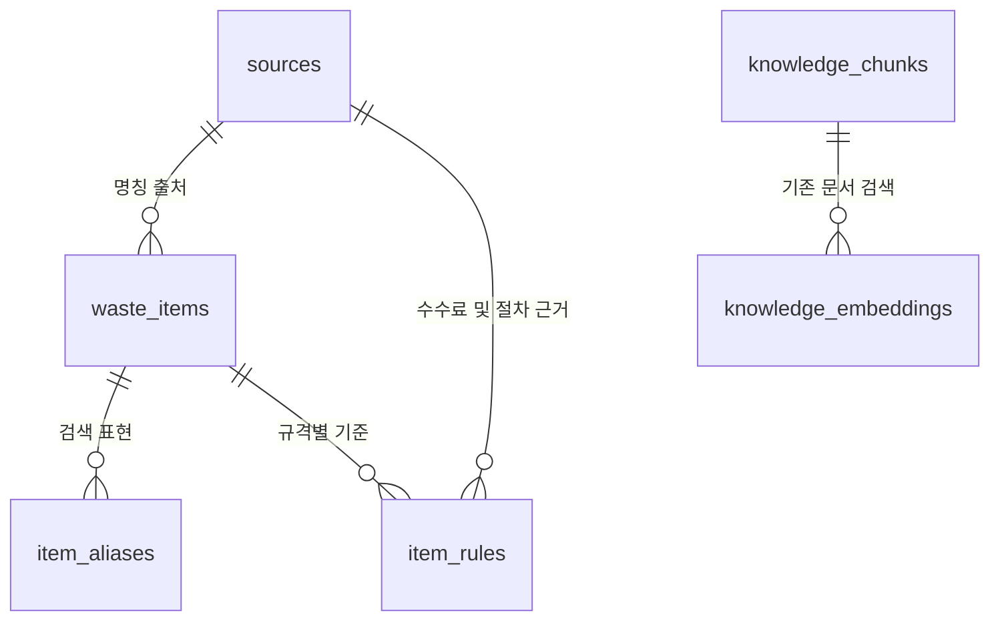

# 양천구 공식 배출 품목 DB

2026-10-18 수집. 공식 대형생활폐기물 **91개 품목명 / 268개 규격별 수수료**를 정리했다. 원문에 보이는 명칭별 개수이며 전국 표준 품목 수를 뜻하지 않는다.

## 데이터와 출처

- 실행용: `data/waste_catalog.json`, 테이블 정의: `data/waste_schema.sql`.
- 상세 정본: 형제 `GreenZone/research/derived/waste_catalog/`의 CSV 4종, JSON, SQLite, SQL, manifest.
- 원본: 형제 `GreenZone/research/raw/yangcheon-bulky-items-20261018.html`, `yangcheon-bulky-guide-20261018.html`.
- [공식 품목·수수료 페이지](https://smartclean.yangcheon.go.kr/online/bulky/item)의 공개 HTML에 포함된 Vue 품목 배열을 추출했다. 로그인·신고·결제·비공개 API 호출 없이 취득했다.
- [공식 이용 안내](https://smartclean.yangcheon.go.kr/online/bulky/guide)로 신고·배출증·수거 시점·일반 예외를 확인했다.
- 기준일·시행기간은 원문에 명시되지 않아 null로 둔다. 2026-10-18은 확인일이며 시행일이 아니다. 원본 바이트 수·SHA256은 정본 manifest에 기록한다.

## ERD와 테이블

| 테이블 | 주요 필드 | 의미 |
|---|---|---|
| 기존 `sources` 확장 | source_id, title, url, reference_date, checked_at, content_hash | 원문·확인일·원본 해시. 기존 행 보존 |
| `waste_items` | item_id, official_name, category, official_category, source_id, active | 공식 명칭·분류 |
| `item_aliases` | alias_id, item_id, alias, normalized_alias, origin | 원문 명칭과 프로젝트 검색어 구분 |
| `item_rules` | rule_id, item_id, district_code, source_item_code, specification, fee_krw, conditions, housing_type, source_id, guide_source_id, checked_at, effective_from/until, verification_status, snapshot_id, active | 지역·규격별 수수료와 근거 |

기존 `rules`는 분류별 기본 안내에 사용한다. 이번 수수료를 그 테이블에 덮어쓰지 않으며 새 테이블은 품목별 조회에 사용한다. 기존 후보·건물·관리자 수정·문서 벡터는 유지한다. 임베딩은 별도 벡터 DB로 옮기지 않는다.

## 질문 처리

1. 표준 품목명·다른 표현을 검색한다. 프로젝트 동의어는 공식 행정 규칙이 아니다.
2. 긴 품목명 내부의 짧은 명칭은 중복 판정하지 않는다. 예: 안마의자 안의 의자, 김치냉장고 안의 냉장고.
3. 별개의 품목이 함께 나오거나 ‘식탁’처럼 재질에 따라 여러 품목이 검색되면 하나를 고르도록 안내한다.
4. 한 품목의 규격별 수수료를 원문 그대로 보여준다. 무게·치수·수량을 임의로 추정하거나 합산하지 않는다.
5. 공식 신고 절차와 출처·확인일을 함께 표시한다. 조회되지 않은 품목은 기존 문서 검색·기본 안내로 이어진다.

`/api/chat`에서는 이 조회가 BGE-M3 검색보다 먼저다. 표에서 찾은 비용에는 모델이나 유사도 점수를 사용하지 않는다. `/api/waste-items?q=안마의자`는 구조화 결과, `/api/waste-items/status`는 자료 개수를 반환한다. 두 조회에 모델 호출은 없다.

## 실제 확보한 안마의자 항목

| 원문 규격 | 원문 수수료 | 원문 품목 코드 |
|---|---:|---|
| 소형(100kg 미만) | 10,000원 | 111 |
| 대형(100kg 이상) | 15,000원 | 112 |

수수료는 확인일의 공식 표에 표시된 값이다. 개별 수거 승인·확정 견적·최종 결제를 뜻하지 않는다. 크기·무게가 일반 제품의 2배 이상 차이 나면 가격 조정 안내가 있어 결제 전에 최신 공식 표와 문의로 확인해야 한다.

## 아직 없는 자료

- 일반쓰레기·재활용·폐건전지의 상세 품목별 규칙과 실제 수거함 좌표.
- 강서구 수수료·배출 규칙. 양천구 값을 다른 지역으로 복사하지 않는다.
- 동·건물·주거형태별 배출 가능 위치와 운영 승인. `housing_type=not_specified`는 모든 주거형태에 대한 확인 완료를 뜻하지 않는다.
- 무료수거 기관의 품목별 예외 원본. 원문 품목명에 ‘무상수거 불가한 경우에만 해당’이 있으면 그 제한을 그대로 보존하며 무료 여부를 단정하지 않는다.
- 규격 구간이 겹치거나 부품별 금액이 있는 행은 자동 해석하지 않는다. 원문 그대로 보여주고 규격 확인을 요청한다.

## 갱신과 실행

상세 정본에서 `scripts/build_waste_catalog.py`는 저장한 공식 원본을 CSV/JSON으로 변환하고, `scripts/export_waste_database.py`는 공유용 SQLite/SQL을 만든다. 두 작업은 네트워크·모델 호출을 하지 않는다. 원본을 바꾸면 새 날짜의 파일과 출처 기록을 먼저 준비해야 한다.

프리뷰 웹 시작 시 실행용 JSON을 등록한다. 원본에서 사라진 자동 등록 행은 삭제 대신 비활성화하며 다른 수동 관리 자료는 보존한다. 현재 소스 복사 방식의 Docker에서는 `docker compose up -d --build web`으로 반영한다. 이 품목표를 쓰기 위해 벡터 재색인·모델 재학습·새 API 키 발급은 필요하지 않다.

이번 작업은 데이터 수집·정리·DB 등록과 연결이다. 자동 테스트·실제 질문 응답·브라우저 확인·모델 추론 수행과 구분해 보고한다.

웹 반영 기록: Docker 웹 재빌드·시작 후 상태 API에서 품목 91개·수수료 268건·검색 표현 163개 등록과 기존 문서 색인 6개 보존을 확인했다. 실제 질문·브라우저 확인·모델 호출·자동 테스트는 수행하지 않았다.
